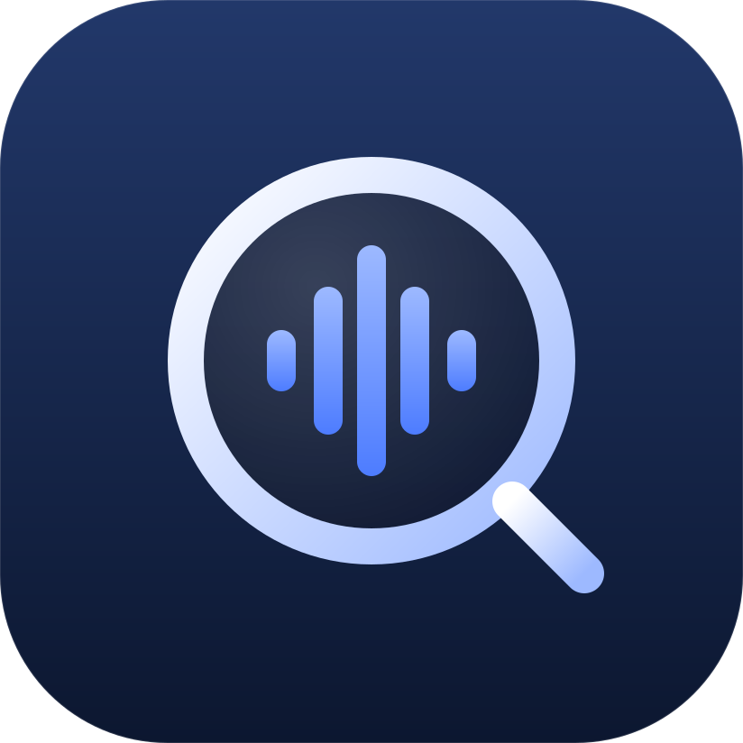
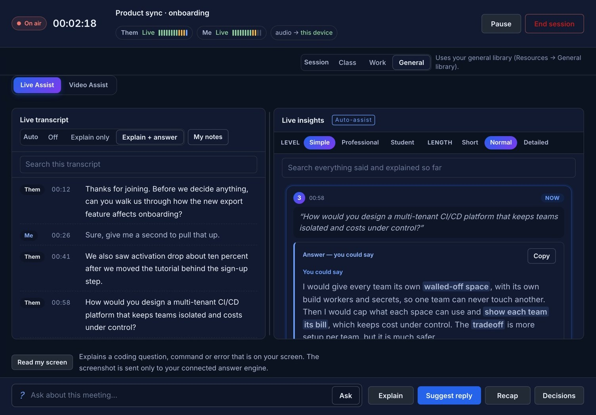

<div align="center">



# Kinviva

### Every conversation, clearer.

A free, local-first desktop app that listens to a meeting, call, interview or lecture,
explains each point in plain words, and helps you answer. For Mac and Windows. No account.

[](https://github.com/Bhaktabahadurthapa/kinviva/actions/workflows/ci.yml)
[](https://github.com/Bhaktabahadurthapa/kinviva/releases/latest)
-0B1020)


**[Download](https://github.com/Bhaktabahadurthapa/kinviva/releases/latest)** &nbsp;·&nbsp;
**[Website](https://kinviva.tech/)** &nbsp;·&nbsp;
**[Compare](https://kinviva.tech/compare.html)** &nbsp;·&nbsp;
**[Blog](https://kinviva.tech/blog.html)** &nbsp;·&nbsp;
**[Discord](https://discord.gg/FbRuQTapz)** &nbsp;·&nbsp;
**[Docs](#docs)**

<br>



<sub>Meetings screen, sample data.</sub>

</div>

---

## What it is

Kinviva hears the audio your computer plays and your microphone, writes a live transcript on your computer,
explains each finished point in simple words, and, when someone asks a question, drafts an answer you can edit.
Nothing is typed into the call. Sessions, notes and keys stay on your computer unless you choose a cloud AI service.

| | |
|---|---|
| **Understand it live** | Plain-English explanations beside a live transcript, with hard words listed |
| **Respond with context** | Question detection and editable reply drafts grounded in your notes and documents |
| **Keep what mattered** | Saved, searchable sessions; decisions and action items with the quote behind each; export to Word, Markdown or text |
| **Technical Copilot** | Read-only troubleshooting plans, an incident tracker, and architecture diagrams labelled verified, mentioned or inferred |
| **Interview, classroom, presentation** | Practice and feedback, study guides and quizzes, an editable PowerPoint maker |
| **Private by design** | No account, no Kinviva server, no telemetry. Local speech recognition and a local-model option |

**What is planned, not built:** Pro and Business editions, including AI agents that complete approved tasks, organisation accounts and shared workflows. See [Editions](#editions).

## Get it

- **Mac (Apple silicon, macOS 13+):** download [Kinviva.dmg](https://github.com/Bhaktabahadurthapa/kinviva/releases/latest/download/Kinviva.dmg).
- **Windows 10/11 (experimental):** download [Kinviva-Windows-Setup.exe](https://github.com/Bhaktabahadurthapa/kinviva/releases/latest/download/Kinviva-Windows-Setup.exe). It has not been tested on real Windows hardware by the maintainer.
- You also need an answer engine: your own cloud key, or a free local model through [Ollama](https://ollama.com). Setup steps are in [Quickstart](#quickstart).

## Features

| | |
|---|---|
| **Two channels** | Other participants ("Them", system audio) and you ("Me", microphone), each with status, a level meter and clear errors. Switch microphones mid-meeting. |
| **Live transcript** | Partial text appears as people talk and settles into timecoded final lines. |
| **Hands-free reading view** | **Auto-assist** (on by default): the screen splits into *Live transcript* on one side and *Live insights* on the other. When someone else finishes a sentence, its meaning appears below in large, plain language, and questions get a draft answer — no clicks. Switch to *Explain only* or *Off* any time. |
| **Architecture diagrams** | The **Architecture** screen turns what people describe (AWS, Kubernetes, CI/CD, databases, incidents) into a diagram with zoom, pan, full screen, editable Mermaid source and SVG/PNG export. Every box is labelled *verified*, *mentioned* or *inferred*. See `docs/architecture/architecture-visualization.md`. |
| **Explain** | The latest point in short, plain-English sentences that keep the speaker's meaning and flag what the transcript left unclear. |
| **Suggest reply** | A short, editable draft grounded in the transcript, your notes and your documents. It never invents your experience, and nothing is sent into the meeting. |
| **Recap and Ask** | Bullet recap of the meeting so far, or a direct question answered from what was said. |
| **Documents** | TXT, Markdown and PDF, indexed with SQLite FTS5. Every answer lists the passages it used. |
| **Overlay** | A movable, resizable, always-on-top companion window. |
| **History** | Search, rename, reopen in the assistant, export Markdown or text. |
| **Shortcuts** | Configurable global shortcuts, plus optional question highlighting with cooldown and duplicate suppression. |

Answers stream as they generate and can be cancelled. With Auto-assist off, the AI runs only when you press a button.

## How it works

<p align="center">
  <a href="docs/media/how-kinviva-works.png"></a>
</p>

<p align="center"><sub>Green is local, purple is the app, orange is optional cloud. Solid lines are the main flow; dashed lines are optional. Click the image for full size.</sub></p>

**In words:** you pick a session type and press Start. Kinviva captures the call audio (<em>Them</em>) and your microphone (<em>Me</em>), turns speech into a live transcript, and, when an answer is needed, builds context from the transcript, matching passages of your own documents and your session instructions. A local model (or a cloud service you choose) writes the explanation or draft. You edit it. Everything is saved on your computer.

One Tauri 2 app: a Rust backend for native audio, speech providers, SQLite
and the OS keychain, and a React + TypeScript interface. No server, no
account. Details in [docs/ARCHITECTURE.md](docs/ARCHITECTURE.md).

| Layer | Choices |
|---|---|
| Speech-to-text | **whisper.cpp** on device (bundled C++ engine in the Mac app, or the `whisper-cli` tool), or **Deepgram** streaming |
| Language model | **Ollama** / LM Studio on device, or any OpenAI-compatible API. You pick the model; none is hardcoded. A 7B model such as `qwen2.5:7b` is recommended over 3B for accuracy. |
| Storage | SQLite with versioned migrations, on device |
| Secrets | macOS Keychain / Windows Credential Manager |

## Quickstart

**Requirements:** macOS 13+, Rust stable, Node 20+, Xcode Command Line Tools.

```bash
git clone https://github.com/Bhaktabahadurthapa/kinviva.git
```

```bash
cd kinviva && npm install && npm run tauri dev
```

For a fully local setup (free, nothing leaves your Mac):

```bash
brew install ollama && ollama pull qwen2.5:7b
```

Download a Whisper model such as
[`ggml-small.en.bin`](https://huggingface.co/ggerganov/whisper.cpp/tree/main)
(more accurate than base). The speech engine itself is built into the Mac app;
when running from source, build it once with `./native/whisperd/build.sh`
(needs `cmake` and a C++ compiler) or install `whisper-cpp` and choose the
command-line tool in Settings.
Then open **Setup** in the app:

1. **Audio:** choose system audio and/or microphone. macOS asks for
   Microphone and Screen & System Audio Recording permission the first time
   you start a meeting.
2. **Speech:** choose whisper.cpp and pick the model file, or paste a
   Deepgram key.
3. **AI:** pick the Ollama preset (or add an API key), press **Fetch models**
   and choose one.

No audio handy? **History → + Demo** adds a sample meeting, clearly marked
DEMO, so you can try the AI actions.

## Install as a Mac app

**Just want the app?** **[⬇ Download Kinviva.dmg](https://github.com/Bhaktabahadurthapa/kinviva/releases/latest/download/Kinviva.dmg)**
(direct download, 15 MB, Apple Silicon). Checksums and notes are on the
[release page](https://github.com/Bhaktabahadurthapa/kinviva/releases/latest);
the [website](https://kinviva.tech/) has the same button.

To build it yourself instead, create a normal app you can drag into Applications (Apple Silicon Mac, macOS 13+):

```bash
./scripts/build-mac-app.sh
```

This creates `dist-mac/Kinviva.app` and `dist-mac/Kinviva_0.1.7_aarch64.dmg`.
Open the DMG, drag **Kinviva** onto **Applications**, then open it from
Launchpad. On first start macOS asks for **Microphone** and **Screen & System
Audio Recording** permission; allow both, then quit and reopen the app once.

- **Your own Mac:** works as is, because you built it yourself.
- **Someone else's Mac:** the app is not yet notarized by Apple, so macOS
  blocks the first open. Open it once, click **Done**, then go to System
  Settings → Privacy & Security, scroll down and click **Open Anyway**
  (macOS 15 and later; on older versions right-click the app → **Open**).
  A warning-free download needs an Apple Developer ID ($99/year) to sign and
  notarize it.

### Windows (experimental)

**[⬇ Download Kinviva-Windows-Setup.exe](https://github.com/Bhaktabahadurthapa/kinviva/releases/latest/download/Kinviva-Windows-Setup.exe)**
(5.5 MB, Windows 10/11 64-bit). This first Windows build compiles and passes
its unit tests on a Windows build server, but has **not been tried on a real
Windows laptop yet**, so expect rough edges, especially audio capture.

1. Run the installer. Windows shows **"Windows protected your PC"** because
   it isn't signed: click **More info → Run anyway**. It installs for your
   user only (no administrator needed).
2. Allow **Microphone** access when asked. System audio is captured from your
   default output device (WASAPI loopback), so play the call through your normal
   speakers or headphones.
3. For free local AI install
   [Ollama for Windows](https://ollama.com/download) and
   [whisper.cpp](https://github.com/ggml-org/whisper.cpp/releases)
   (`whisper-cli.exe`) plus a model file, then set the paths in
   **Settings → Speech**.

The installer is built by the **Build Windows** GitHub Action
(`.github/workflows/windows.yml`), free for public repositories. Removing the
SmartScreen warning needs a paid code-signing certificate.

<details>
<summary><b>Tests, release build and hardware probes</b></summary>

```bash
npm test
```

```bash
cd src-tauri && cargo test
```

```bash
npm run tauri build
```

- `cargo run --example e2e_probe -- <whisper-cli> <model.bin> <llm-base-url> <model> <seconds>`
  captures real system and mic audio, transcribes it, runs the AI actions,
  tests cancellation, and checks persistence and export.
- `cargo run --example sck_probe -- <audio-file>` reports the ScreenCaptureKit
  audio format and level while playing a file.
- `VITE_SELFTEST=1 npm run tauri dev` runs a dev-only script that clicks
  through Start → Explain → Suggest reply → overlay → Stop → History.

</details>

## Privacy

- **On device by default:** with whisper.cpp and Ollama, no audio or text
  leaves your computer.
- **You can always see where data goes:** chips in the app show whether
  audio and AI text stay local or go to a named cloud host, and whether AI
  help is *automatic* or *on request*. With a cloud AI provider, Auto-assist
  sends what others say as they speak; turn it off if that isn't what you want.
- **Keys** live in the OS credential store, never in files or logs.
- **Recordings are off by default;** a visible indicator shows when they're
  on.
- **No telemetry,** no account, no update checks.
- **Consent matters:** some places require everyone's consent to record or
  transcribe a conversation. Tell participants when you use Kinviva.

## Status

| | macOS (Apple Silicon) | Windows |
|---|---|---|
| Build | ✅ verified on macOS 27 | ✅ builds and unit tests pass on a Windows build server |
| Real-audio pipeline | ✅ whisper.cpp (bundled C++ engine and `whisper-cli`) + Ollama | ⚠️ not yet tried on a real Windows laptop; bundled engine passes CI protocol tests (fake mode) |
| Deepgram, OpenAI | ⚠️ implemented, awaiting live-key testing | ⚠️ same |

Full results and known limitations: [docs/TESTING.md](docs/TESTING.md).

## Editions

This repository is the **Community Edition**: free, local-first, no account. **Pro** and **Business** editions are *planned* and are **not available yet**; nothing in this repository implements them. See [docs/OPEN_CORE_PLAN.md](docs/OPEN_CORE_PLAN.md) and [docs/FEATURE_AUDIT.md](docs/FEATURE_AUDIT.md) for what exists today and what does not. The code is public to read, but it is currently under an all-rights-reserved licence ([licensing review](docs/LICENSING_REVIEW.md)).

## Community

Join the [Kinviva Discord](https://discord.gg/FbRuQTapz) for help and ideas (community support, no response-time guarantee; Discord is a third-party service). Confirmed bugs belong in [GitHub issues](https://github.com/Bhaktabahadurthapa/kinviva/issues).

## Tests

Rust: 179 unit tests (2 need network and are ignored). Front end: 83 tests. Early Access service: 10 tests. They run on every push in [CI](.github/workflows/ci.yml). Tests cover logic, validators and prompt construction; they do not drive real audio devices or a real answer engine. Details and known limits: [docs/TESTING.md](docs/TESTING.md).

## Docs

- [How answers are written](docs/ANSWERS.md): format, sources and citation checking
- [Meeting sessions](docs/SESSIONS.md): Class / Work / General, courses and citations
- [Interview practice](docs/INTERVIEW.md): skills, modes, limitations
- [Architecture](docs/ARCHITECTURE.md) · [Languages and why](docs/LANGUAGES.md)
- [Design system](docs/DESIGN_SYSTEM.md)
- [Test results & limitations](docs/TESTING.md)
- [Reference investigation & feature coverage](docs/FINDINGS.md): an
  independent implementation; see that file for how the reference app was
  studied.
- [Open-core plan](docs/OPEN_CORE_PLAN.md) · [Release readiness](docs/RELEASE_READINESS.md) · [Privacy](docs/PRIVACY.md)
- [Contributing](CONTRIBUTING.md) · [Security](SECURITY.md) ·
  [Code of conduct](CODE_OF_CONDUCT.md)
- [Third-party notices](THIRD_PARTY_NOTICES.md)

Data lives in `~/Library/Application Support/app.kinviva.desktop/`; keys
are under the credential-store service `app.kinviva.desktop`.

## License

Proprietary. Copyright © 2026 Bhakta Thapa. All rights reserved. See
[LICENSE](LICENSE). The source is public to read; no right to use, copy,
modify or redistribute it is granted without a separate written license or
subscription agreement. Third-party components keep their own licenses; see
[THIRD_PARTY_NOTICES.md](THIRD_PARTY_NOTICES.md).

